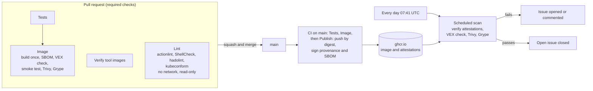

# CI and supply chain security

How the container image of this project is built, checked, published and watched, and what to do
when a check fails. The files named here are the source of truth: when this document and a file
disagree, the file is right, and this document should be fixed in the same pull request.

## 1. Overview



- In every CI run the image is built **once**, and the exact image that was tested is the one
  that is pushed (same digest) and signed.
- Nothing reaches `main` without a pull request whose required checks pass.
- Every day, the published image is scanned again with that day's vulnerability data, without
  rebuilding it.

## 2. Workflows and required checks

| Workflow | File | Runs on | Jobs |
|---|---|---|---|
| CI | `.github/workflows/ci.yml` | Every pull request; push to `main`; version tags `v*` | Tests, Image, Publish (push only) |
| Scheduled scan | `.github/workflows/scheduled-scan.yml` | Every day at 07:41 UTC; by hand; pull requests that change the scan or what it uses | Scan, Notify (never on pull requests) |
| Tool images | `.github/workflows/verify-tools.yml` | Every pull request; by hand | Verify tool images |
| Lint | `.github/workflows/lint.yml` | Every pull request; by hand | Lint |
| PR title | `.github/workflows/pr-title.yml` | Every pull request: opened, title edited, new commits | Conventional Commits |
| CodeQL | `.github/workflows/codeql.yml` | Every pull request; push to `main`; every Monday at 04:17 UTC; by hand | Analyze (actions), Analyze (python) |

**CI jobs**

- **Tests:** `pytest` on Python 3.12, the same minor version as the image.
- **Image:** builds the image once (loaded into Docker for the tests, and saved as an OCI archive
  for Publish), checks that both are the same image, generates the SBOM with Syft, checks the
  VEX exceptions, runs a smoke test on `/health`, and scans with Trivy (the image) and Grype (the
  SBOM).
- **Publish** (pushes only): pushes the tested archive to `ghcr.io` with `skopeo
  --preserve-digests`, checks that every tag points to the tested digest, and signs the build
  provenance and the SBOM with `actions/attest` (keyless, Sigstore). Tags: `sha-<commit>` and
  `main` on `main`, `X.Y.Z` and `X.Y` on version tags, never `latest`.

**Lint** (`.github/scripts/lint.sh`)

- **actionlint** checks the workflows, and the shell of their `run` steps with ShellCheck;
  **ShellCheck** checks the shell scripts; **hadolint** checks the Dockerfiles. Only the files
  tracked by git are linted.
- **kubeconform** checks the Kubernetes manifests: every `kustomization.yaml` is rendered with
  kustomize, as it is applied to the cluster, and each object is validated against the schema of
  its kind and version in `tools/kubeconform/schemas`, in strict mode (an unknown field is an
  error). First, the versions of the schemas must be the ones of the cluster (section 3,
  *Kubernetes schemas*).
- **Prepare** (with network): actionlint, kubeconform and kustomize are built from
  `tools/go/go.mod` in the Go toolchain image, and the ShellCheck and hadolint binaries are copied
  out of their pinned images, the images that Tool images verifies.
- **Lint** (sandbox): each tool runs in a container with no network, a read-only file system and
  no Linux capabilities, as the user that runs the script (not root), with the repository mounted
  read-only. A compromised tool can neither send anything out nor change the code.
- **go.sum** (a step of the Lint job, with network): `.github/scripts/check-go-sum.sh` checks the
  Go modules whose `go.mod` or `go.sum` the pull request changes, and all of them when the check,
  the Lint workflow or the Go toolchain image changes (section 3, *Go tools*).
- The same script runs locally (section 7), so a failure in the CI can be reproduced exactly.
- A finding is fixed, or ignored on that line only, with a comment that says why
  (`# hadolint ignore=DLxxxx`, `# shellcheck disable=SCxxxx`); never for the whole project.

**PR title** (`.github/workflows/pr-title.yml`)

The squash merge makes the title of a pull request the commit on `main`, so the title must follow
Conventional Commits, `type(scope)!: summary`:

- **type:** `build`, `chore`, `ci`, `docs`, `feat`, `fix`, `perf`, `refactor`, `revert`, `style`
  or `test`. The **scope** is optional (lowercase letters, digits and `-`, such as `deps` or
  `platform`), and `!` marks a breaking change.
- **summary:** starts with a lowercase letter or a digit, and does not end with a period.
- **length:** at most 72 characters, the limit of the first line of a commit, except for
  Dependabot, whose titles are generated.
- It runs when a pull request is opened, when its title is edited and on every push. The title
  only reaches the shell as an environment variable; the job has no checkout and no permissions.

**CodeQL** (`.github/workflows/codeql.yml`)

The scanners of the image (section 4) and Dependabot find known vulnerabilities in what we use;
CodeQL looks for security mistakes in the code we write (static analysis, SAST):

- **What:** the Python of the repository (the app and the scripts in Python) and the GitHub
  Actions workflows (for example, an event value pasted into a script). Shell scripts are not
  supported by CodeQL: ShellCheck checks them in the Lint.
- **How:** the `security-extended` queries, from the source (`build-mode: none`), with
  `github/codeql-action` pinned by commit, like every action. The results go to *Security* →
  *Code scanning*.
- **When:** on every pull request, on every push to `main`, and every Monday, because new queries
  can find problems in code that did not change.
- **The gate:** the analysis passes even when it finds something, so it is not a required check.
  The ruleset blocks the merge instead (below, *Branch rules*).

**Permissions and secrets**

- Every workflow starts with no permissions (or `contents: read`), and each job asks only for
  what it needs. Only **Publish** can write packages and sign (`packages`, `id-token`,
  `attestations`); only **Notify** can write issues.
- The repository stores **no secrets**. Publish logs in to `ghcr.io` with the short-lived
  `GITHUB_TOKEN` of the run. Pull requests from forks never receive secrets, and their workflows
  only run after a maintainer approves them (*Require approval for all external contributors*).
- Checkouts use `persist-credentials: false`, and values from the event reach scripts through
  environment variables, never pasted into the script (script injection).

**Branch rules** (ruleset `protect-main`, empty bypass list)

- Changes reach `main` only through pull requests, merged with squash (linear history); force
  pushes and deleting `main` are blocked.
- Required checks: **Tests**, **Image**, **Verify tool images**, **Lint** and **Conventional
  Commits** (the PR title); the branch must be up to date with `main` before merging.
- Code scanning results (*Require code scanning results*): CodeQL must have analysed the pull
  request, and a new security alert of severity **High or higher**, or a new alert of level
  **Error**, blocks the merge.
- Every check runs on every pull request. A workflow skipped by a `paths` filter would leave its
  required check waiting forever, so the Tool images workflow always runs and decides inside
  (with no tool change it passes without verifying anything).
- Every pull request starts from `.github/pull_request_template.md`: what changes and why, how it
  was tested, and a checklist (Conventional Commits title, tests, secrets, pinned versions, VEX,
  documentation). `.github/CODEOWNERS` names who reviews each path.
- The squash commit takes the pull request title and the commit details (repository setting),
  never the pull request description: the history keeps what changed and why, and the checklist
  stays in the pull request. A commit body starts with one or two sentences on why, then a list
  of what changed.

**Team mode** (when a second maintainer joins)

The project has one maintainer, and nobody can approve their own pull request, so no approval is
required today (section 8). When a second maintainer joins:

1. Add them to `.github/CODEOWNERS`, at least for `/.github/`, `/tools/` and
   `docs/ci-security.md`. Every path needs at least two owners (or a team): nobody can approve
   their own pull request, so a path with a single owner would block that owner's own changes.
2. In the `protect-main` ruleset, under *Require a pull request before merging*, set
   *Required approvals* to 1 and turn on *Dismiss stale pull request approvals when new commits
   are pushed*, *Require review from Code Owners*, *Require approval of the most recent
   reviewable push* and *Require conversation resolution before merging*.
3. Keep the bypass list empty.

In an organization, CODEOWNERS would name teams instead of people, and members would need
two-factor authentication.

## 3. Supply chain

**Everything is pinned to an exact version and digest**

| What | Where | Pinned by |
|---|---|---|
| Base image | `app/Dockerfile` | Tag and digest |
| Python libraries | `app/requirements*.txt` | Exact versions |
| GitHub Actions | `.github/workflows/*.yml` | Full commit SHA (version in a comment) |
| Trivy, Syft, Grype, jq, hadolint, ShellCheck, Go toolchain, Python | `tools/<tool>/Dockerfile` | Tag and digest |
| actionlint, kubeconform, kustomize (Go tools) | `tools/go/go.mod` | Exact versions, and the hash of every module in `tools/go/go.sum` |
| helm (Go tool) | `tools/helm/go.mod` | Exact versions, and the hash of every module in `tools/helm/go.sum` |
| PyYAML (the CRD converter) | `tools/python/requirements.txt` | Exact version and the hash of each wheel |
| Sources of the Kubernetes schemas | `tools/kubeconform/versions` | Commit, digest and checksum |

The tool Dockerfiles are never built: the scripts read the image from their `FROM` line. They
exist so that Dependabot can propose new versions.

The tool pins live in `tools/`, outside `.github/`: Dependabot cannot open a pull request that
changes a file under `.github/` for any ecosystem other than GitHub Actions. GitHub refuses it
with "The request contains invalid or unauthorized changes". This is not documented by GitHub
(see dependabot/dependabot-core#15237), and it was found when the first Syft and Grype updates
failed.

**Updates**

Dependabot (`.github/dependabot.yml`) proposes updates every Monday at 06:00 (Europe/Lisbon), only
for releases at least **7 days old** (cooldown), so that a compromised release is likely to be
found and withdrawn before it reaches this project. Security updates are not delayed by the
cooldown. Each update is a normal pull request, with every required check.

Dependabot reads the age of an image from its registry, and the GitHub Container Registry gives
no publication date: for jq and hadolint (`ghcr.io`) the cooldown is not applied, and the update
is proposed on the day of the release. So the age is also enforced by Tool images, for every
tool (below).

**Release age**

Tool images reads the publication date of the GitHub release of each tool (for Go, which has no
GitHub releases, the time in the `VERSION` file of the verified release), and fails if it is
less than **7 days** old (whole days, UTC). This holds whatever the registry, and does not depend
on Dependabot. A pull request opened earlier stays red: run the check again when the release is
old enough.

When a newer release cannot wait (for example, it fixes a vulnerability in the tool itself), add
an exception to `tools/release-age-exceptions.json`, in its own pull request:

```json
{
  "tool": "trivy",
  "tag": "0.76.3",
  "reason": "Fixes GHSA-xxxx-xxxx-xxxx in Trivy itself",
  "expires": "2026-11-20"
}
```

- `tag` is the exact tag of the image in `tools/<tool>/Dockerfile`; the exception covers only
  that tag.
- `reason` is one line, without `|`; `expires` is at most the day the release is 7 days old.
- The summary marks the tool ⚠️, with the reason. An expired exception fails the check of that
  tool until it is removed.

After the exception is merged, update the pull request of the tool with `main` (`@dependabot
rebase`, or *Update with rebase*). Running the check again is not enough: a re-run tests the
same merge commit as before, which does not have the exception.

**Reviewing a Dependabot pull request for a tool**

1. **Files changed:** only the `FROM` line of `tools/<tool>/Dockerfile` (tag and digest).
2. **Tool images:** "Tools to verify" lists only that tool, and its row is ✅ (or ⚠️ for
   ShellCheck).
3. **The release:** `https://github.com/<owner>/<repo>/releases/tag/<tag>`. Its date, and the
   changes that touch what this project uses (search the notes for the features used, such as
   `sbom`, `vex` or `cyclonedx`). Then the **Security** tab of that repository: an advisory that
   affects the current version makes the update urgent.
4. **The pipeline:** CI / Image passes with the new version. For a scanner (Trivy, Grype), compare
   its results with the last run on `main` (the scan step of the Image job): any new or removed
   finding must be explained, and the VEX exceptions must still apply.
5. **Approve** with a comment that says what was checked: origin, age, release notes and
   advisories, and the result in the pipeline. Then squash and merge.

**Reviewing a Dependabot pull request for an action**

1. **Files changed:** only the `uses:` lines of that action, with a new commit SHA and its version
   in the comment.
2. **Origin:** the SHA is the commit of the version tag in the official repository (the commit
   next to the tag on the release page, or `git ls-remote https://github.com/<owner>/<repo>.git
   refs/tags/<tag>`). Any other SHA runs other code.
3. **The release:** its date (at least 7 days, the Dependabot cooldown), what changed for the
   inputs this project uses, and the **Security** tab. For `sigstore/cosign-installer`, the
   `cosign-release` default in its `action.yml`: it is the cosign version the workflows install.
4. **The pipeline:** every workflow that uses the action passes. An action that only runs on
   `main` (such as `docker/login-action`, used by Publish) is proven by the CI on `main` after
   the merge.
5. **Approve** with a comment that says what was checked, then squash and merge.

**Reviewing a Dependabot pull request for a Go module** (`tools/go`, `tools/helm`)

1. **Files changed:** only `go.mod` and `go.sum` of that module. A version update changes the line
   of the tool and of the libraries whose versions it needs; a security update changes the
   library of the alert and the libraries it needs.
2. **Checksums:** in the Lint job, the step *Check go.sum against the checksum database* checked
   that module and passed: every line of `go.sum` is the one of the Go checksum database.
   Dependabot writes the `go.sum` of a security update without the database (below, *Go tools*).
3. **The release:** for a tool, as for a tool image (its date, the notes, the **Security** tab);
   for a security update, the advisory of the alert and its fixed version.
4. **The test:** for `tools/go`, Lint builds and runs the tools. helm never runs in the Lint: run
   `.github/scripts/update-k8s-schemas.sh`, and the schemas must not change
   (`git status --short tools/kubeconform/schemas` shows nothing), or their diff is reviewed.
5. **Approve** with a comment that says what was checked, then squash and merge.

**A pull request behind `main`**

Use *Update branch* → **Update with rebase** (never *Update with merge commit*), then review and
merge it soon: Dependabot stops managing a pull request that someone else updated, so it would not
rebase it again or close it when a newer version comes. GitHub removed several Dependabot comment
commands in January 2026, and in this repository `@dependabot rebase` was never processed (pull
requests #25 and #33: no Dependabot job ran), so the comment commands are not used.

**Tool images** (`.github/scripts/verify-tool-image.sh`)

A digest only proves that the image never changes, not who built it. On a pull request that
changes a tool Dockerfile, the Tool images workflow checks that the image is the official image
of the version in its tag:

| Tool | The image is signed? | What is verified |
|---|---|---|
| Trivy | Yes | The image signature: made by the Trivy release workflow, at the tag of that version and at the commit of that tag |
| Syft, Grype | No | The signature of the release checksums (release workflow, commit of the version tag), the sha256 of the release archive, and that the binary in the image is the release binary |
| jq | Attested | The provenance attestation of the image and of the release binary, and that the binary in the image is the release binary |
| hadolint | No | The provenance attestation of the release binary (read from the GitHub API; release workflow, commit of the version tag), and that the binary in the image is the release binary |
| ShellCheck | No | ShellCheck publishes no signatures: only that the binary in the image (Docker Hub) is the binary of the GitHub release. The summary marks it ⚠️ |
| Go toolchain (`golang`) | No | The Go release, published by the Go team as the module `golang.org/toolchain` in the public Go checksum database, downloaded by the Go of the image reviewed before (the base branch), never by the image under check: every file of the module is in `/usr/local/go`, byte for byte (only tests and documentation may be extra). The image has no entrypoint, no other `go` before `/usr/local/go/bin` on its `PATH`, and only the variables of the official image |

The rest of the Go toolchain image (Debian, gcc, git) is not compared, and it never runs in a
build: the Go tools are built with `CGO_ENABLED=0` (no C compiler), modules only come from the Go
module proxy (no git), and the Go binaries are static (they do not load the C library of the
image). Each Go image is checked by the one before it; the first one, `golang:1.27.3-trixie`, was
also checked without any Go, in the pull request that added the check: the hash of its module,
computed with Python from the module file, is the one in the checksum database.

Docker pulls by digest and ignores the tag, so without this check a pull request could show a
harmless tag with the digest of another image, and every other check would still pass. Only the
`linux/amd64` binary is compared: it is the one the runners execute.

**Go tools** (`tools/go/go.mod`)

actionlint, kubeconform and kustomize are built from source with the Go toolchain image
(`tools/golang/Dockerfile`, a Docker Official Image pinned by digest, like the base image of
the application). The Go toolchain checks every module against `tools/go/go.sum`. The public Go
checksum database (`sum.golang.org`) is an append-only log: every user gets exactly the same code
for a version, and published code cannot be replaced. The toolchain only asks it when a line is
added to `go.sum`: a build trusts the lines that are already there.

helm has a module of its own, `tools/helm/go.mod`. In one module every library has one version,
the highest that any tool asks for: in `tools/go`, helm would change the libraries of the Lint
tools (for example the JSON schema library of kubeconform). helm only runs when the schemas are
updated, never in the Lint.

`.github/scripts/check-go-sum.sh <module folder>` checks every line of the `go.sum` of a module: it
writes a new `go.sum` with `go mod tidy`, with the database on and an empty module cache, and
compares it with the one of the repository. Both `go.sum` files are tidy, the form that
Dependabot writes. The Lint runs it on every pull request that changes a `go.mod` or a `go.sum`,
and on every module when the check, the Lint workflow or the Go toolchain image changes: a new
Go may write `go.sum` differently, and the difference is then seen in that pull request.

The tools are `// indirect` in `go.mod` (the `tool` directive requires them, no code imports
them), and Dependabot only updates direct dependencies by default: until November 2026 it never
proposed a new version of a Go tool. Each `gomod` entry of `.github/dependabot.yml` has two kinds
of `allow` rules: the default rule (`dependency-type: direct`) and each tool by name, of any type
(`dependency-type: all`). An allow list replaces the default rule, also for security updates, so
the default rule is written again:

| | Version updates | Security updates |
|---|---|---|
| The tools | Yes (their rules by name) | Yes |
| Their libraries | No: none is a direct dependency, and they come with each release of the tool | Yes: security updates do not check the dependency type |

Tested in a test repository (November 2026), with an `// indirect` library with known advisories
(`github.com/ulikunitz/xz` v0.5.7): with the rules by name only, its security update was blocked
("all versions were ignored"); with the default rule added, the pull request opened (v0.5.14, the
lowest version without the advisories), and the alerts closed as fixed after the merge. The test
also showed that:

- a change of the `allow` rules does not run a failed security update again: use *Try again* on
  the alert;
- Dependabot runs the security updates for Go with `GONOSUMDB=*` (seen in the job definition, at
  the start of the log), so the new lines of `go.sum` are not checked against the database. The
  Lint runs `check-go-sum.sh` (above).

**Kubernetes schemas** (`tools/kubeconform/`)

kubeconform validates each object against a JSON schema of its kind and version. The schemas are
kept in the repository, so the Lint needs no network and gives the same result for a commit:

| Kinds | Source | Pinned by |
|---|---|---|
| Namespace, Deployment, Service | `yannh/kubernetes-json-schema`, for the Kubernetes version of `kind/cluster.yaml` | Commit |
| GatewayClass, Gateway, HTTPRoute | The CRDs of the `gateway-crds-helm` chart of Envoy Gateway, rendered with the values of `scripts/install-platform.sh` | Digest |
| Certificate, ClusterIssuer | The CRDs of the cert-manager release | Checksum |

`.github/scripts/update-k8s-schemas.sh` generates them from `tools/kubeconform/versions`. With
network, it builds helm, pulls the chart and downloads the CRDs, the core schemas and PyYAML;
with no network, helm renders the chart and `.github/scripts/crd-to-jsonschema.py` converts each
served version of the listed CRDs into a strict schema. The same versions always give the same
files.

- **A new version** (Kubernetes, Envoy Gateway or cert-manager): change it in
  `tools/kubeconform/versions` with its new commit, digest or checksum, run the script, review the
  diff of the schemas, and commit both with the change of `kind/cluster.yaml` or
  `scripts/install-platform.sh`. Until then, the Lint fails: the versions must match.
- **A new kind** in the manifests: add it to `CORE_SCHEMAS` or `CRD_KINDS` and run the script.
  Until then, the Lint fails with `could not find schema`.
- `tools/kubeconform/versions` is read with `sed`, never run.

## 4. Vulnerability policy

**Gates**

The CI (on every pull request and on `main`) and the scheduled scan fail on **HIGH** or
**CRITICAL** vulnerabilities **that already have a fix**. Two scanners, same policy:

- **Trivy** (`.github/scripts/scan-trivy.sh`) scans the image, and also looks for secrets.
- **Grype** (`.github/scripts/scan-grype.sh`) scans the SBOM, and also reads compiled binaries
  such as the Python interpreter, which Trivy does not see.

Their databases are updated at different times, so one can find a new vulnerability a day before
the other.

**Accepted vulnerabilities (VEX)**

Exceptions are declared in `.github/vex/openvex.json` (OpenVEX), read by both scanners.
OpenVEX has no expiry date, so `.github/scripts/check-vex.sh` enforces the rules:

- Only `status: not_affected`, with one of the five OpenVEX justifications and an
  `impact_statement` that explains why the vulnerable code cannot be reached.
- Each product is a package URL pinned to a version, without qualifiers:
  `pkg:deb/debian/apt@3.0.3`. A Debian version with an epoch (`1:...`) needs **two** products: the
  version with the epoch, as in the SBOM (read by Grype), and the version without it (read by
  Trivy, which moves the epoch to a qualifier).
- A statement expires **30 days** after its date (`last_updated`, else `timestamp`): from then on,
  the CI and the scheduled scan fail until it is reviewed. A future date is an error.
- A product that is no longer in the image gives a warning: the statement can be removed.

**Working with exceptions**

- **Add:** only after checking the vulnerability in the distribution's tracker and showing that
  the vulnerable code is not reachable. The tracker must list the CVE **for that package**, and so
  must the fix: for Debian, the DSA, or the changelog of the package when the fix comes in a point
  release. A scanner can show the wrong title, and its database can even link a CVE to the wrong
  package. For a function of a shared library, `readelf --dyn-syms` on every ELF file of the
  image shows that none imports it. Add a statement with today's `timestamp`, raise the document
  `version` and set its `last_updated`, and test locally (section 7) before opening the pull
  request.
- **Renew:** review the analysis again, and check that both scanners still show the CVE as
  suppressed by VEX; if it still holds, set the statement's `last_updated` to the review date, in
  a pull request that says what was reviewed.
- **Remove:** when the fixed package reaches the image (the VEX check warns), remove the statement
  in the same pull request that updates the image. In a Dependabot pull request, add that commit
  after *Update with rebase* (Dependabot no longer manages the pull request by then), or remove
  the statement in a pull request right after the merge. Remove it too when the CVE turns out not
  to affect that package (a wrong match in a scanner database).

An exception is temporary: the preferred fix is always a new image with the fixed package.

## 5. Verifying the published image

The image is published as `ghcr.io/ian-k-rebelo/devops-pipeline-e2e`. Verify it by digest, with
[cosign](https://github.com/sigstore/cosign):

```bash
IMAGE=ghcr.io/ian-k-rebelo/devops-pipeline-e2e
docker buildx imagetools inspect "${IMAGE}:main"   # copy the "Digest:" line
DIGEST=sha256:...
IDENTITY=https://github.com/ian-k-rebelo/devops-pipeline-e2e/.github/workflows/ci.yml@refs/heads/main
ISSUER=https://token.actions.githubusercontent.com

# Build provenance: built by the CI workflow on main
cosign verify-attestation --type https://slsa.dev/provenance/v1 \
  --certificate-identity "${IDENTITY}" --certificate-oidc-issuer "${ISSUER}" \
  "${IMAGE}@${DIGEST}" > /dev/null

# SBOM (CycloneDX), signed by the same workflow
cosign verify-attestation --type https://cyclonedx.org/bom \
  --certificate-identity "${IDENTITY}" --certificate-oidc-issuer "${ISSUER}" \
  "${IMAGE}@${DIGEST}" > /dev/null
```

For an image published from a version tag, the identity ends in `@refs/tags/vX.Y.Z` instead of
`@refs/heads/main`. The scheduled scan runs these same checks before every scan.

## 6. Runbook: the scheduled scan failed

The Notify job opens an issue labelled `scheduled-scan` (or comments on the open one), with the
link to the run. GitHub also emails whoever last changed the schedule about the failed run.

1. **Open the run** and find the failed step:

   | Failed step | Meaning |
   |---|---|
   | Read the digest of main, Verify attestations | The published image or its signatures: check the last Publish run |
   | Check VEX exceptions | A statement expired or is malformed: review it (section 4) |
   | Scan image / Scan SBOM | A new HIGH or CRITICAL vulnerability with a fix |
   | Install jq, cosign-installer | Infrastructure (download, network): run the workflow again |

2. **For a vulnerability:** confirm it in the tracker of the distribution or the project (for
   Debian, `security-tracker.debian.org`): affected versions, fixed version, and what the flaw
   is.
3. **Choose the fix:**
   - a new base image with the fixed package exists: update the digest in `app/Dockerfile` (a
     manual security update does not wait for the Dependabot cooldown);
   - no new image yet, and the vulnerable code is not reachable: a temporary VEX exception, with
     the reason and the exit (section 4);
   - no new image with the fix yet, and the code is reachable: install the fixed package in the
     Dockerfile, with its exact version (hadolint DL3008), until the base image has it. The step
     first checks the version in the base image and fails the build when it is already fixed, so
     it is removed in the pull request that updates the base image. Dependabot cannot remove it:
     its pull request for that base image fails CI / Image, so push a commit that removes the
     step to that branch, or close it and open a pull request with both changes.
4. **Open a pull request** with the fix; every required check must pass. Its description refers
   to the issue with `Refs #N`: a closing keyword followed by the number (`close`, `fixes`,
   `resolved` and their other forms) closes the issue at the merge, before the scan proves the
   fix. Before merging, the *Development* section of the pull request must not list the issue.
5. **After the merge,** run **Scheduled scan** by hand (Actions, *Run workflow*, on `main`). When it
   passes, Notify closes the issue.

**Incidents.** In each one, Debian had fixed a package of the official Python image before the
image was rebuilt; the issue links the failed runs, and the pull request has the analysis:

| Issue | Finding | Decision | Fix |
|---|---|---|---|
| #18 | `zlib1g`: CVE-2026-85091 and CVE-2026-76844 (HIGH), in the `gz*` file functions | Not reachable: the app only reaches zlib through the Python `zlib` module, which never calls them. Temporary VEX exception | #19 (2026-11-09) |
| #37 | `libc6`, `libc-bin`: CVE-2026-19499 and CVE-2026-5435 (HIGH in Grype), fixed in the Debian 13.8 point release | Not reachable: no ELF file of the image imports `strfmon`, `strfmon_l` or the `libresolv` printing functions (`readelf --dyn-syms`). Temporary VEX exception | #41 (2026-11-23) |
| #45 | `libzstd1`: CVE-2026-124851 (HIGH in Trivy), in the decompression of zstd | Reachable: `libcrypto` (OpenSSL) imports the zstd decompression functions, and the app loads it (Python `hashlib` and `ssl`). New base image, with the fixed package installed until the base image has it; the new image also ended the exceptions of #18 and #37 | #46 (2026-11-25) |

In #18, CVE-2026-76844 turned out to be a wrong match in the Trivy database: the Debian tracker
lists it for `webpack-dev-middleware` (NOT-FOR-US), and the zlib fix, DSA-6613-1, is for
CVE-2026-27171 and CVE-2026-85091. When both scanners stopped showing it, its statement was
removed (#35). In #45, the description of the pull request had a closing keyword, so the merge
closed the issue before the scan; it was reopened, and the manual scan closed it (step 4).

## 7. Audit and local checks

**Evidence**

- **Tool images, run by hand** (Actions, *Run workflow*): verifies the seven tool images and lists
  each one in the job summary, with the release date, the commit and the date.
- **Dependabot, every Monday** after 06:00: *Insights* → *Dependency graph* → *Dependabot*. A
  failed update job is not notified anywhere else, and a ⚠️ shows a warning (such as the cooldown
  not applied to `ghcr.io`).
- **Dependabot alerts, every Monday:** *Security* → *Dependabot alerts*. An open alert without a
  pull request is a security update that failed or was blocked: its page shows the error, and
  *Try again* after the fix.
- **Code scanning alerts, every Monday:** *Security* → *Code scanning*, after the weekly CodeQL
  analysis. Each open alert is fixed, or dismissed with the reason (*false positive*, *won't
  fix*, *used in tests*).
- **A new automation is proven by its result,** not by a green job: a new Dependabot entry by a
  pull request it opens, a new check by a negative test that makes it fail.
- **Run logs and summaries** are kept for 90 days (the GitHub default). Reports that must be kept
  longer are attached to the GitHub release of each version.
- **Attestations** (provenance and SBOM) are stored in GitHub and next to the image in `ghcr.io`.

**Running the checks locally**

Requirements: Docker, [cosign](https://github.com/sigstore/cosign) 3.1.4 (the version the workflows
install, the default of the pinned `sigstore/cosign-installer`), git, curl, jq. No `sudo`.

```bash
.github/scripts/install-jq.sh ~/.local/bin            # the same jq as the CI
.github/scripts/verify-tool-image.sh grype            # or: trivy syft jq hadolint shellcheck golang
.github/scripts/lint.sh                               # the same lint as the CI
.github/scripts/check-go-sum.sh tools/go              # or tools/helm: go.sum against sum.golang.org
.github/scripts/update-k8s-schemas.sh                 # after a change in tools/kubeconform/versions
.github/scripts/check-vex.sh .github/vex/openvex.json sbom.cdx.json
.github/scripts/scan-trivy.sh remote "ghcr.io/ian-k-rebelo/devops-pipeline-e2e@${DIGEST}"
.github/scripts/scan-grype.sh sbom.cdx.json
```

`VEX_TODAY=YYYY-MM-DD` tests the expiry of the VEX exceptions on another date. For
`verify-tool-image.sh`, `TOOL_DOCKERFILE` points at another Dockerfile, `TOOL_EXCEPTIONS` at
another exceptions file, and `TOOL_TODAY=YYYY-MM-DD` tests the release age on another date. They
exist only for tests. For `golang`, `GOLANG_VERIFIER_IMAGE` replaces the image whose Go downloads
the Go release (by default, the one of the parent commit).

`lint.sh` keeps the Go module and build cache in `~/.cache/devops-pipeline-e2e/lint` between runs
(`LINT_CACHE` replaces the folder), shared with `update-k8s-schemas.sh` and
`scripts/deploy-local.sh`. Go makes its module cache read-only: to delete it, run `chmod -R u+w`
on the folder first.

## 8. Known limitations

- **Tools used before they are verified:** in a pull request that changes a tool image, the CI,
  the scheduled scan and Lint run that tool while Tool images verifies it. A bad image cannot be
  merged, publish or reach secrets (the jobs only read, and there are none), but it runs on the
  temporary runner and can lie about that pull request's results; in Lint it has no network and
  cannot change the code. Planned: verify the tool first.
- **No second reviewer:** the project has one maintainer, and GitHub does not let authors approve
  their own pull requests, so no approval is required. Compensating controls: the required
  checks, the empty bypass list, the approval of outside pull requests, CODEOWNERS and the pull
  request checklist. The settings for a team are ready (section 2, *Team mode*).
- **Only `linux/amd64`** binaries of the tools are compared, the platform of the runners.
- **Code scanning merge protection only sees the lines of the pull request:** an alert in code
  that a pull request does not change (for example, found by new queries in the weekly analysis)
  does not block it. It is in *Security* → *Code scanning*, reviewed every Monday (section 7).
- **A VEX statement that no scanner uses is not detected:** the VEX check reads the SBOM, so it
  warns when a package leaves the image, not when the scanners stop showing the CVE (for example
  after a database fix). The renewal review checks the scanners' output (section 4).
- **kubeconform does not evaluate the CEL rules of the CRDs** (`x-kubernetes-validations`), for
  example the rules that combine two fields of an HTTPRoute: only the API server does. Planned: a
  server-side dry run (`kubectl apply --dry-run=server`) in a kind cluster, in the CD stage.
- **ShellCheck publishes no signatures:** its image can only be compared with its GitHub release,
  so a compromise of both channels would not be detected.
- **Dependabot cannot apply the cooldown to `ghcr.io`** (jq, hadolint): it proposes those updates
  on the day of the release, and the release age check of Tool images blocks them until they are
  7 days old.
- **The allow rules for security updates of Go libraries were tested in a test repository:** in
  this repository they will only be seen when an advisory affects one of the libraries.
- **Dependabot comment commands are not used:** GitHub removed several of them in January 2026,
  and `@dependabot rebase` was never processed in this repository; *Update with rebase* is used
  instead (section 3).
- **Scheduled runs can be late:** GitHub delays them under load (a delay of more than 6 hours has
  been seen). One run a day is still enough.
- **Evidence retention:** run logs last 90 days, and release attachments can be deleted by an
  admin. Tamper-proof storage (for example an object store with a retention lock) is not used.
- **The image check in the Image job** compares the config digest with the image ID, which only
  holds for Docker's classic image store, the one used by the runners.
- **A package installed with its exact version can disappear:** a Debian repository usually keeps
  only the newest version of each package, so when a newer fix of a package that the Dockerfile
  installs is published (section 6, step 3), that version leaves `trixie-security` and every
  build fails until the Dockerfile is updated. The step is temporary for this reason too.
- **The base image is the source of most findings:** the three incidents of November 2026 (#18,
  #37, #45) were packages of the official Python image (section 6). Planned: evaluate a smaller
  base image, with fewer packages to scan and to update.
