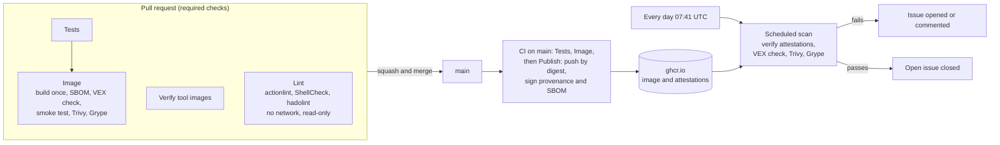

# CI and supply chain security

How the container image of this project is built, checked, published and watched, and what to do
when a check fails. The files named here are the source of truth: when this document and a file
disagree, the file is right, and this document should be fixed in the same pull request.

## 1. Overview



- In every CI run the image is built **once**, and the exact image that was tested is the one
  that is pushed (same digest) and signed.
- Nothing reaches `main` without a pull request whose required checks pass.
- Every day, the published image is scanned again with that day's vulnerability data, without
  rebuilding it.

## 2. Workflows and required checks

| Workflow | File | Runs on | Jobs |
|---|---|---|---|
| CI | `.github/workflows/ci.yml` | Every pull request; push to `main`; version tags `v*` | Tests, Image, Publish (push only) |
| Scheduled scan | `.github/workflows/scheduled-scan.yml` | Every day at 07:41 UTC; by hand; pull requests that change the scan or what it uses | Scan, Notify (never on pull requests) |
| Tool images | `.github/workflows/verify-tools.yml` | Every pull request; by hand | Verify tool images |
| Lint | `.github/workflows/lint.yml` | Every pull request; by hand | Lint |

**CI jobs**

- **Tests:** `pytest` on Python 3.12, the same minor version as the image.
- **Image:** builds the image once (loaded into Docker for the tests, and saved as an OCI archive
  for Publish), checks that both are the same image, generates the SBOM with Syft, checks the
  VEX exceptions, runs a smoke test on `/health`, and scans with Trivy (the image) and Grype (the
  SBOM).
- **Publish** (pushes only): pushes the tested archive to `ghcr.io` with `skopeo
  --preserve-digests`, checks that every tag points to the tested digest, and signs the build
  provenance and the SBOM with `actions/attest` (keyless, Sigstore). Tags: `sha-<commit>` and
  `main` on `main`, `X.Y.Z` and `X.Y` on version tags, never `latest`.

**Lint** (`.github/scripts/lint.sh`)

- **actionlint** checks the workflows, and the shell of their `run` steps with ShellCheck;
  **ShellCheck** checks the shell scripts; **hadolint** checks the Dockerfiles. Only the files
  tracked by git are linted.
- **Prepare** (with network): actionlint is built from `tools/go/go.mod` in the Go toolchain
  image, and the ShellCheck and hadolint binaries are copied out of their pinned images, the
  images that Tool images verifies.
- **Lint** (sandbox): each tool runs in a container with no network, a read-only file system and
  no Linux capabilities, as the user that runs the script (not root), with the repository mounted
  read-only. A compromised tool can neither send anything out nor change the code.
- The same script runs locally (section 7), so a failure in the CI can be reproduced exactly.
- A finding is fixed, or ignored on that line only, with a comment that says why
  (`# hadolint ignore=DLxxxx`, `# shellcheck disable=SCxxxx`); never for the whole project.

**Permissions and secrets**

- Every workflow starts with no permissions (or `contents: read`), and each job asks only for
  what it needs. Only **Publish** can write packages and sign (`packages`, `id-token`,
  `attestations`); only **Notify** can write issues.
- The repository stores **no secrets**. Publish logs in to `ghcr.io` with the short-lived
  `GITHUB_TOKEN` of the run. Pull requests from forks never receive secrets, and their workflows
  only run after a maintainer approves them (*Require approval for all external contributors*).
- Checkouts use `persist-credentials: false`, and values from the event reach scripts through
  environment variables, never pasted into the script (script injection).

**Branch rules** (ruleset `protect-main`, empty bypass list)

- Changes reach `main` only through pull requests, merged with squash (linear history); force
  pushes and deleting `main` are blocked.
- Required checks: **Tests**, **Image**, **Verify tool images** and **Lint**; the branch must be
  up to date with `main` before merging.
- Every check runs on every pull request. A workflow skipped by a `paths` filter would leave its
  required check waiting forever, so the Tool images workflow always runs and decides inside
  (with no tool change it passes without verifying anything).
- Every pull request starts from `.github/pull_request_template.md`: what changes and why, how it
  was tested, and a checklist (Conventional Commits title, tests, secrets, pinned versions, VEX,
  documentation). `.github/CODEOWNERS` names who reviews each path.
- The squash commit takes the pull request title and the commit details (repository setting),
  never the pull request description: the history keeps what changed and why, and the checklist
  stays in the pull request. A commit body starts with one or two sentences on why, then a list
  of what changed.

**Team mode** (when a second maintainer joins)

The project has one maintainer, and nobody can approve their own pull request, so no approval is
required today (section 8). When a second maintainer joins:

1. Add them to `.github/CODEOWNERS`, at least for `/.github/`, `/tools/` and
   `docs/ci-security.md`. Every path needs at least two owners (or a team): nobody can approve
   their own pull request, so a path with a single owner would block that owner's own changes.
2. In the `protect-main` ruleset, under *Require a pull request before merging*, set
   *Required approvals* to 1 and turn on *Dismiss stale pull request approvals when new commits
   are pushed*, *Require review from Code Owners*, *Require approval of the most recent
   reviewable push* and *Require conversation resolution before merging*.
3. Keep the bypass list empty.

In an organization, CODEOWNERS would name teams instead of people, and members would need
two-factor authentication.

## 3. Supply chain

**Everything is pinned to an exact version and digest**

| What | Where | Pinned by |
|---|---|---|
| Base image | `app/Dockerfile` | Tag and digest |
| Python libraries | `app/requirements*.txt` | Exact versions |
| GitHub Actions | `.github/workflows/*.yml` | Full commit SHA (version in a comment) |
| Trivy, Syft, Grype, jq, hadolint, ShellCheck, Go toolchain | `tools/<tool>/Dockerfile` | Tag and digest |
| actionlint, kubeconform, kustomize (Go tools) | `tools/go/go.mod` | Exact versions, and the hash of every module in `tools/go/go.sum` |

The tool Dockerfiles are never built: the scripts read the image from their `FROM` line. They
exist so that Dependabot can propose new versions.

The tool pins live in `tools/`, outside `.github/`: Dependabot cannot open a pull request that
changes a file under `.github/` for any ecosystem other than GitHub Actions. GitHub refuses it
with "The request contains invalid or unauthorized changes". This is not documented by GitHub
(see dependabot/dependabot-core#15237), and it was found when the first Syft and Grype updates
failed.

**Updates**

Dependabot (`.github/dependabot.yml`) proposes updates every Monday at 06:00 (Europe/Lisbon), only
for releases at least **7 days old** (cooldown), so that a compromised release is likely to be
found and withdrawn before it reaches this project. Security updates are not delayed by the
cooldown. Each update is a normal pull request, with every required check.

Dependabot reads the age of an image from its registry, and the GitHub Container Registry gives
no publication date: for jq and hadolint (`ghcr.io`) the cooldown is not applied, and the update
is proposed on the day of the release. So the age is also enforced by Tool images, for every
tool (below).

**Release age**

Tool images reads the publication date of the GitHub release of each tool, and fails if it is
less than **7 days** old (whole days, UTC). This holds whatever the registry, and does not depend
on Dependabot. A pull request opened earlier stays red: run the check again when the release is
old enough.

When a newer release cannot wait (for example, it fixes a vulnerability in the tool itself), add
an exception to `tools/release-age-exceptions.json`, in its own pull request:

```json
{
  "tool": "trivy",
  "tag": "0.76.3",
  "reason": "Fixes GHSA-xxxx-xxxx-xxxx in Trivy itself",
  "expires": "2026-11-20"
}
```

- `tag` is the exact tag of the image in `tools/<tool>/Dockerfile`; the exception covers only
  that tag.
- `reason` is one line, without `|`; `expires` is at most the day the release is 7 days old.
- The summary marks the tool ⚠️, with the reason. An expired exception fails the check of that
  tool until it is removed.

After the exception is merged, update the pull request of the tool with `main` (`@dependabot
rebase`, or *Update with rebase*). Running the check again is not enough: a re-run tests the
same merge commit as before, which does not have the exception.

**Reviewing a Dependabot pull request for a tool**

1. **Files changed:** only the `FROM` line of `tools/<tool>/Dockerfile` (tag and digest).
2. **Tool images:** "Tools to verify" lists only that tool, and its row is ✅ (or ⚠️ for
   ShellCheck).
3. **The release:** `https://github.com/<owner>/<repo>/releases/tag/<tag>`. Its date, and the
   changes that touch what this project uses (search the notes for the features used, such as
   `sbom`, `vex` or `cyclonedx`). Then the **Security** tab of that repository: an advisory that
   affects the current version makes the update urgent.
4. **The pipeline:** CI / Image passes with the new version. For a scanner (Trivy, Grype), compare
   its results with the last run on `main` (the scan step of the Image job): any new or removed
   finding must be explained, and the VEX exceptions must still apply.
5. **Approve** with a comment that says what was checked: origin, age, release notes and
   advisories, and the result in the pipeline. Then squash and merge.

If the pull request is behind `main`, comment `@dependabot rebase`. If Dependabot does not react
within a few minutes, use *Update branch* → **Update with rebase** (never *Update with merge
commit*); Dependabot then stops managing that pull request, so merge it soon.

**Tool images** (`.github/scripts/verify-tool-image.sh`)

A digest only proves that the image never changes, not who built it. On a pull request that
changes a tool Dockerfile, the Tool images workflow checks that the image is the official image
of the version in its tag:

| Tool | The image is signed? | What is verified |
|---|---|---|
| Trivy | Yes | The image signature: made by the Trivy release workflow, at the tag of that version and at the commit of that tag |
| Syft, Grype | No | The signature of the release checksums (release workflow, commit of the version tag), the sha256 of the release archive, and that the binary in the image is the release binary |
| jq | Attested | The provenance attestation of the image and of the release binary, and that the binary in the image is the release binary |
| hadolint | No | The provenance attestation of the release binary (read from the GitHub API; release workflow, commit of the version tag), and that the binary in the image is the release binary |
| ShellCheck | No | ShellCheck publishes no signatures: only that the binary in the image (Docker Hub) is the binary of the GitHub release. The summary marks it ⚠️ |

Docker pulls by digest and ignores the tag, so without this check a pull request could show a
harmless tag with the digest of another image, and every other check would still pass. Only the
`linux/amd64` binary is compared: it is the one the runners execute.

**Go tools** (`tools/go/go.mod`)

actionlint, kubeconform and kustomize are built from source with the Go toolchain image
(`tools/golang/Dockerfile`, a Docker Official Image pinned by digest, like the base image of
the application). The Go toolchain checks every module against `tools/go/go.sum`, and the
hashes in `go.sum` are checked against the public Go checksum database, an append-only log: every
user gets exactly the same code for a version, and published code cannot be replaced.

## 4. Vulnerability policy

**Gates**

The CI (on every pull request and on `main`) and the scheduled scan fail on **HIGH** or
**CRITICAL** vulnerabilities **that already have a fix**. Two scanners, same policy:

- **Trivy** (`.github/scripts/scan-trivy.sh`) scans the image, and also looks for secrets.
- **Grype** (`.github/scripts/scan-grype.sh`) scans the SBOM, and also reads compiled binaries
  such as the Python interpreter, which Trivy does not see.

Their databases are updated at different times, so one can find a new vulnerability a day before
the other.

**Accepted vulnerabilities (VEX)**

Exceptions are declared in `.github/vex/openvex.json` (OpenVEX), read by both scanners.
OpenVEX has no expiry date, so `.github/scripts/check-vex.sh` enforces the rules:

- Only `status: not_affected`, with one of the five OpenVEX justifications and an
  `impact_statement` that explains why the vulnerable code cannot be reached.
- Each product is a package URL pinned to a version, without qualifiers:
  `pkg:deb/debian/apt@3.0.3`. A Debian version with an epoch (`1:...`) needs **two** products: the
  version with the epoch, as in the SBOM (read by Grype), and the version without it (read by
  Trivy, which moves the epoch to a qualifier).
- A statement expires **30 days** after its date (`last_updated`, else `timestamp`): from then on,
  the CI and the scheduled scan fail until it is reviewed. A future date is an error.
- A product that is no longer in the image gives a warning: the statement can be removed.

**Working with exceptions**

- **Add:** only after checking the vulnerability in the distribution's tracker (the scanner's
  title can be wrong) and showing that the vulnerable code is not reachable. Add a statement with
  today's `timestamp`, raise the document `version` and set its `last_updated`, and test locally
  (section 7) before opening the pull request.
- **Renew:** review the analysis again; if it still holds, set the statement's `last_updated` to
  the review date, in a pull request that says what was reviewed.
- **Remove:** when the fixed package reaches the image (the VEX check warns), remove the statement
  in the same pull request that updates the image.

An exception is temporary: the preferred fix is always a new image with the fixed package.

## 5. Verifying the published image

The image is published as `ghcr.io/ian-k-rebelo/devops-pipeline-e2e`. Verify it by digest, with
[cosign](https://github.com/sigstore/cosign):

```bash
IMAGE=ghcr.io/ian-k-rebelo/devops-pipeline-e2e
docker buildx imagetools inspect "${IMAGE}:main"   # copy the "Digest:" line
DIGEST=sha256:...
IDENTITY=https://github.com/ian-k-rebelo/devops-pipeline-e2e/.github/workflows/ci.yml@refs/heads/main
ISSUER=https://token.actions.githubusercontent.com

# Build provenance: built by the CI workflow on main
cosign verify-attestation --type https://slsa.dev/provenance/v1 \
  --certificate-identity "${IDENTITY}" --certificate-oidc-issuer "${ISSUER}" \
  "${IMAGE}@${DIGEST}" > /dev/null

# SBOM (CycloneDX), signed by the same workflow
cosign verify-attestation --type https://cyclonedx.org/bom \
  --certificate-identity "${IDENTITY}" --certificate-oidc-issuer "${ISSUER}" \
  "${IMAGE}@${DIGEST}" > /dev/null
```

For an image published from a version tag, the identity ends in `@refs/tags/vX.Y.Z` instead of
`@refs/heads/main`. The scheduled scan runs these same checks before every scan.

## 6. Runbook: the scheduled scan failed

The Notify job opens an issue labelled `scheduled-scan` (or comments on the open one), with the
link to the run. GitHub also emails whoever last changed the schedule about the failed run.

1. **Open the run** and find the failed step:

   | Failed step | Meaning |
   |---|---|
   | Read the digest of main, Verify attestations | The published image or its signatures: check the last Publish run |
   | Check VEX exceptions | A statement expired or is malformed: review it (section 4) |
   | Scan image / Scan SBOM | A new HIGH or CRITICAL vulnerability with a fix |
   | Install jq, cosign-installer | Infrastructure (download, network): run the workflow again |

2. **For a vulnerability:** confirm it in the tracker of the distribution or the project (for
   Debian, `security-tracker.debian.org`): affected versions, fixed version, and what the flaw
   is.
3. **Choose the fix:**
   - a new base image with the fixed package exists: update the digest in `app/Dockerfile` (a
     manual security update does not wait for the Dependabot cooldown);
   - no new image yet, and the vulnerable code is not reachable: a temporary VEX exception, with
     the reason and the exit (section 4);
   - no new image yet, and the code is reachable: install the fixed package in the Dockerfile
     until the base image has it.
4. **Open a pull request** with the fix; every required check must pass.
5. **After the merge,** run **Scheduled scan** by hand (Actions, *Run workflow*, on `main`). When it
   passes, Notify closes the issue.

**Example:** in November 2026, the scan found two HIGH vulnerabilities in `zlib1g`, in the `gz*`
file functions (issue #18). Debian had fixed them, but the official Python image had not been
rebuilt yet, and the app only reaches zlib through the Python `zlib` module, which never calls
those functions. They were accepted with a temporary VEX exception (pull request #19), and the
manual scan closed the issue.

## 7. Audit and local checks

**Evidence**

- **Tool images, run by hand** (Actions, *Run workflow*): verifies the six tool images and lists
  each one in the job summary, with the release date, the commit and the date.
- **Dependabot, every Monday** after 06:00: *Insights* → *Dependency graph* → *Dependabot*. A
  failed update job is not notified anywhere else, and a ⚠️ shows a warning (such as the cooldown
  not applied to `ghcr.io`).
- **A new automation is proven by its result,** not by a green job: a new Dependabot entry by a
  pull request it opens, a new check by a negative test that makes it fail.
- **Run logs and summaries** are kept for 90 days (the GitHub default). Reports that must be kept
  longer are attached to the GitHub release of each version.
- **Attestations** (provenance and SBOM) are stored in GitHub and next to the image in `ghcr.io`.

**Running the checks locally**

Requirements: Docker, [cosign](https://github.com/sigstore/cosign) (the version set by `cosign-release` in
the workflows), git, curl, jq. No `sudo`.

```bash
.github/scripts/install-jq.sh ~/.local/bin            # the same jq as the CI
.github/scripts/verify-tool-image.sh grype            # trivy, syft, grype, jq, hadolint or shellcheck
.github/scripts/lint.sh                               # the same lint as the CI
.github/scripts/check-vex.sh .github/vex/openvex.json sbom.cdx.json
.github/scripts/scan-trivy.sh remote "ghcr.io/ian-k-rebelo/devops-pipeline-e2e@${DIGEST}"
.github/scripts/scan-grype.sh sbom.cdx.json
```

`VEX_TODAY=YYYY-MM-DD` tests the expiry of the VEX exceptions on another date. For
`verify-tool-image.sh`, `TOOL_DOCKERFILE` points at another Dockerfile, `TOOL_EXCEPTIONS` at
another exceptions file, and `TOOL_TODAY=YYYY-MM-DD` tests the release age on another date. They
exist only for tests.

`lint.sh` keeps the Go module and build cache in `~/.cache/devops-pipeline-e2e/lint` between runs
(`LINT_CACHE` replaces the folder). Go makes its module cache read-only: to delete it, run
`chmod -R u+w` on the folder first.

## 8. Known limitations

- **Tools used before they are verified:** in a pull request that changes a tool image, the CI,
  the scheduled scan and Lint run that tool while Tool images verifies it. A bad image cannot be
  merged, publish or reach secrets (the jobs only read, and there are none), but it runs on the
  temporary runner and can lie about that pull request's results; in Lint it has no network and
  cannot change the code. Planned: verify the tool first.
- **The Go toolchain image is not verified yet:** it is pinned by digest and is a Docker Official
  Image, like the base image of the application, but it is not compared with the Go release yet.
  It builds the Go tools, with network. Planned: compare the Go in the image with the checksums
  published by the Go team on go.dev.
- **No second reviewer:** the project has one maintainer, and GitHub does not let authors approve
  their own pull requests, so no approval is required. Compensating controls: the required
  checks, the empty bypass list, the approval of outside pull requests, CODEOWNERS and the pull
  request checklist. The settings for a team are ready (section 2, *Team mode*).
- **Only `linux/amd64`** binaries of the tools are compared, the platform of the runners.
- **ShellCheck publishes no signatures:** its image can only be compared with its GitHub release,
  so a compromise of both channels would not be detected.
- **Dependabot cannot apply the cooldown to `ghcr.io`** (jq, hadolint): it proposes those updates
  on the day of the release, and the release age check of Tool images blocks them until they are
  7 days old.
- **Dependabot commands can be ignored:** `@dependabot rebase` was ignored twice on one pull
  request; *Update with rebase* is the fallback (section 3).
- **Scheduled runs can be late:** GitHub delays them under load (a delay of more than 6 hours has
  been seen). One run a day is still enough.
- **Evidence retention:** run logs last 90 days, and release attachments can be deleted by an
  admin. Tamper-proof storage (for example an object store with a retention lock) is not used.
- **The image check in the Image job** compares the config digest with the image ID, which only
  holds for Docker's classic image store, the one used by the runners.
